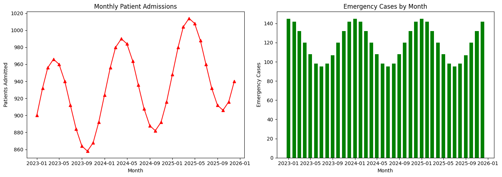

# 🏥 Hospital Patient Statistics Dashboard Using Python

## 📌 Project Overview

This project creates a Hospital Patient Statistics Dashboard using Python and data visualization techniques.

It analyzes monthly patient admissions and emergency cases using two different visualizations displayed side by side with Matplotlib subplots.

## 🎯 Objectives

- Analyze monthly hospital patient admissions.
- Visualize emergency cases over time.
- Create multiple plots using Matplotlib subplots.
- Understand data analysis and visualization using Python.

## 🛠️ Technologies Used

- **Python** – Programming language
- **Pandas** – Data manipulation and analysis
- **NumPy** – Numerical operations
- **Matplotlib** – Data visualization
- **Google Colab** – Development environment

## 📂 Project Structure

```text
Hospital-Patient-Statistics-Dashboard/
│
├── Hospital_Patient_Statistics.ipynb
├── hospital_patient_statistics.csv
├── hospital_dashboard.png
└── README.md
```

## 📊 Dataset Information

The project uses an external CSV dataset named `hospital_patient_statistics.csv`.

The dataset contains 36 monthly records from January 2023 to December 2025.

| Column | Description |
|---|---|
| Month | Monthly observation date |
| Patients Admitted | Number of patients admitted |
| Emergency Cases | Number of emergency cases |

**Note:** The dataset contains simulated hospital statistics generated using mathematical formulas. It does not represent real hospital records.

## ⚙️ Installation and Execution

**Step 1:** Clone the repository.

```bash
git clone https://github.com/karanbagade236-sketch/Hospital-Patient-Statistics-Dashboard.git
```

**Step 2:** Navigate to the project folder.

```bash
cd Hospital-Patient-Statistics-Dashboard
```

**Step 3:** Install the required libraries.

```bash
pip install pandas numpy matplotlib
```

**Step 4:** Open the Jupyter Notebook or upload it to Google Colab.

**Step 5:** Ensure the CSV dataset is available and run the notebook cells.

## 📈 Project Output

The dashboard generates two visualizations:

1. **Monthly Patient Admissions** – Red line graph with triangle markers.
2. **Emergency Cases by Month** – Green bar graph.

### Dashboard Preview



## 💡 Key Learning Outcomes

- Reading external CSV files using Pandas.
- Working with date ranges and monthly data.
- Using NumPy for numerical operations.
- Creating multiple plots using Matplotlib subplots.
- Customizing graph titles, labels and colors.
- Saving visualizations as PNG images.

## 👨‍💻 Author

**Karan N B**

Computer Science and Engineering Student

## 📜 License

This project is intended for educational and learning purposes.
